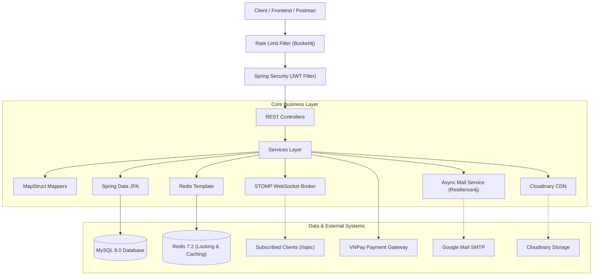
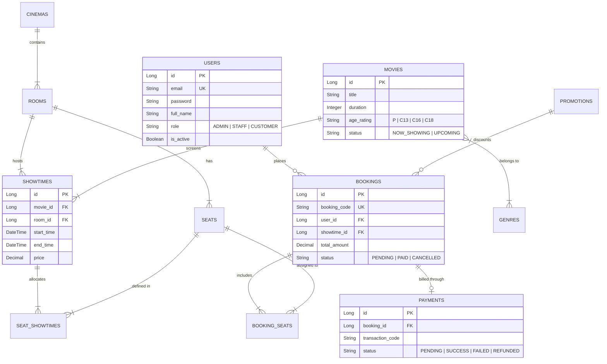
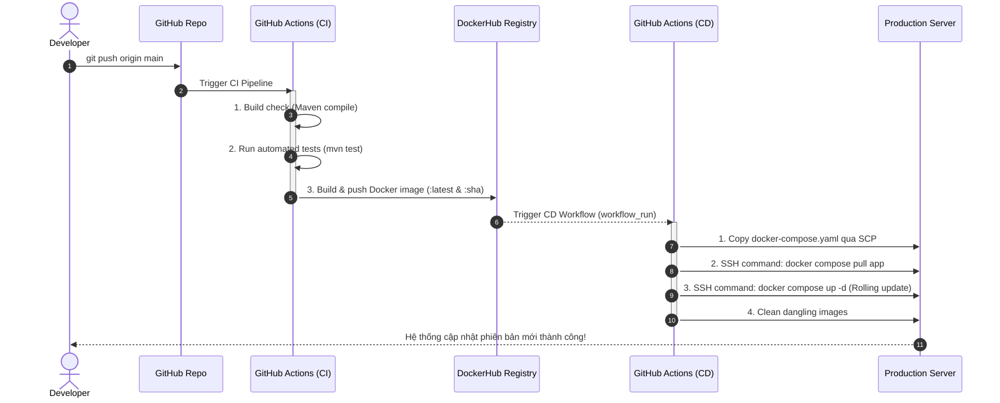

<div align="center">

# 🎬 CINEBOOK API - CINEMA TICKET BOOKING SYSTEM
### *Hệ Thống Đặt Vé Xem Phim Phân Tán, Thời Gian Thực & Thanh Toán Trực Tuyến*

[](https://www.oracle.com/java/)
[](https://spring.io/projects/spring-boot)
[](https://www.mysql.com/)
[](https://redis.io/)
[](https://www.docker.com/)
[](https://github.com/features/actions)
[](LICENSE)

<p align="center">
  <b>CineBook</b> là hệ thống Backend chuyên nghiệp giải quyết bài toán đặt vé xem phim quy mô lớn với tính năng khóa ghế đồng thời (distributed locking), cập nhật trạng thái ghế theo thời gian thực (WebSocket), tích hợp cổng thanh toán VNPay (HMAC-SHA512) và pipeline CI/CD tự động hóa 100%.
</p>

</div>

---

## 📌 MỤC LỤC
1. [Điểm Nổi Bật Về Kỹ Thuật (Key Technical Highlights)](#-điểm-nổi-bật-về-kỹ-thuật)
2. [Kiến Trúc Hệ Thống (System Architecture)](#-kiến-trúc-hệ-thống)
3. [Công Nghệ & Công Cụ Sử Dụng (Tech Stack)](#-công-nghệ--công-cụ-sử-dụng)
4. [Mô Hình Dữ Liệu & ERD (Data Modeling)](#-mô-hình-dữ-liệu)
5. [Tập Lệnh RESTful API (API Endpoints)](#-tập-lệnh-restful-api)
6. [Chiến Lược Kiểm Thử (Testing Strategy)](#-chiến-lược-kiểm-thử)
7. [Hạ Tầng & Tự Động Hóa CI/CD (DevOps)](#-hạ-tầng--tự-động-hóa-cicd)
8. [Hướng Dẫn Cài Đặt & Khởi Chạy (Quick Start)](#-hướng-dẫn-cài-đặt--khởi-chạy)
9. [Bảo Mật & Best Practices](#-bảo-mật--best-practices)

---

## 🚀 ĐIỂM NỔI BẬT VỀ KỸ THUẬT

Dự án không dừng lại ở mức ứng dụng CRUD cơ bản mà tập trung xử lý các bài toán kỹ thuật phức tạp thường gặp trong các hệ thống phân tán thực tế:

### 1. Xử Lý Tranh Chấp Ghế Đồng Thời (Distributed Seat Locking & Concurrency Control)
- **Vấn đề:** Khi có hàng ngàn người dùng cùng bấm đặt một ghế VIP tại cùng một thời điểm mở bán phim bom tấn, hiện tượng race condition có thể dẫn đến **Double-Booking** (bán trùng ghế).
- **Giải pháp:**
  - Áp dụng kỹ thuật **Redis `SETNX` (atomic lock)** với thời gian giữ chỗ mặc định 15 phút (`900s`).
  - Tích hợp cơ chế **Automatic Rollback**: Nếu việc giữ một chuỗi ghế thất bại ở bất kỳ ghế nào, hệ thống tự động giải phóng toàn bộ các ghế đã được lock trước đó, đảm bảo tính nguyên tử (**Atomicity**).
  - Tự động hết hạn và nhả ghế khi đơn hàng quá thời gian chờ thanh toán.

### 2. Đồng Bộ Trạng Thái Ghế Thời Gian Thực (Realtime WebSocket / STOMP)
- Tích hợp **Spring WebSocket + STOMP Messaging**.
- Khi một khách hàng giữ ghế hoặc hủy vé thành công, hệ thống broadcast sự kiện qua topic `/topic/showtimes/{showtimeId}/seats`. Toàn bộ người dùng đang mở sơ đồ ghế của phòng chiếu đó sẽ thấy trạng thái ghế chuyển đổi ngay lập tức trên UI mà không cần tải lại trang.

### 3. Cổng Thanh Toán VNPay & Cơ Chế Hoàn Tiền (Payment Gateway & Refund)
- Tích hợp **VNPay Sandbox API** với chuẩn mã hóa toàn vẹn dữ liệu **HMAC-SHA512**.
- Xử lý **IPN / Callback Webhook**: Xác minh chữ ký số, cập nhật trạng thái đơn vé, chuyển đổi trạng thái ghế sang `BOOKED`, và cập nhật số lượt sử dụng mã khuyến mãi.
- Hỗ trợ API **Hoàn tiền (VNPay Refund)** với truy vấn bảo mật và kiểm tra quyền admin nghiêm ngặt.

### 4. Giới Hạn Tần Suất Yêu Cầu (API Rate Limiting - Bucket4j)
- Tích hợp thuật toán **Token Bucket** thông qua thư viện `Bucket4j` ở tầng Servlet Filter.
- Phân luồng giới hạn theo IP:
  - **Auth Plan:** `15 requests/phút` (chống Brute-Force Password & Spam đăng ký tài khoản).
  - **General Plan:** `60 requests/phút` (chống DoS / Scraping dữ liệu rạp và phim).
- Trả về mã lỗi HTTP `429 Too Many Requests` kèm header `Retry-After`.

### 5. Xử Lý Bất Đồng Bộ & Khả Năng Tự Phục Hồi (Async & Resilience4j)
- Gửi email xác nhận đặt vé định dạng HTML giàu nội dung qua `@Async` (Thread Pool riêng), không làm nghẽn luồng xử lý thanh toán chính.
- Tích hợp **Resilience4j `@Retry`**: Tự động thử lại tối đa 3 lần với khoảng cách 3 giây khi gặp sự cố mạng tạm thời với SMTP server, đi kèm phương thức `fallback` an toàn.

### 6. Đảm Bảo Tính Lũy Đẳng & Chống Xử Lý Trùng Lặp (Idempotency & State Guard)
- **Vấn đề:** Trong môi trường mạng và hệ thống phân tán, các tín hiệu Webhook từ bên thứ ba (VNPay IPN/Callback) hoặc thao tác từ người dùng (như click đúp hủy vé, hoàn tiền) có thể bị gửi lặp lại nhiều lần. Nếu không có cơ chế xử lý lũy đẳng, hệ thống dễ rơi vào tình trạng **Double-Processing** (xử lý hóa đơn nhiều lần, hoàn tiền trùng, spam email, hoặc trừ/cộng sai số lượt ưu đãi).
- **Giải pháp:**
  - **Idempotent Webhook Consumer:** Áp dụng kỹ thuật kiểm tra trạng thái (*State Guard*) tại luồng tiếp nhận callback VNPay (`PaymentServiceImpl.vnpayCallback`). Nếu đơn vé đã ở trạng thái `PAID` hoặc thanh toán đã là `SUCCESS`, hệ thống lập tức bỏ qua và phản hồi ngay, đảm bảo không thực hiện lại các hiệu ứng phụ (side-effects) như cập nhật ghế hay gửi trùng email.
  - **State Transition Guard:** Kiểm soát chặt chẽ máy trạng thái trước khi thực hiện các tác vụ nhạy cảm như hủy vé (`cancelBooking`) và hoàn tiền (`refundPayment`), chặn đứng các yêu cầu thao tác lặp lại trên vé hoặc khoản thanh toán đã hoàn tất xử lý.
  - **Ràng Buộc Độc Nhất (Database Unique Constraint):** Áp dụng ràng buộc duy nhất `unique = true` cho quan hệ giữa `Payment` và `Booking`, ngăn chặn nguy cơ sinh nhiều bản ghi giao dịch cho cùng một đơn đặt vé.

---

## 🏗 KIẾN TRÚC HỆ THỐNG



---

## 🛠 CÔNG NGHỆ & CÔNG CỤ SỬ DỤNG

| Lĩnh vực | Công nghệ / Thư viện | Vai trò |
| :--- | :--- | :--- |
| **Core Framework** | **Java 21**, **Spring Boot 4.1.0** | Nền tảng phát triển ứng dụng hiệu năng cao |
| **Security** | **Spring Security 6**, **OAuth2 Resource Server**, **Nimbus JOSE+JWT** | Xác thực phân quyền RBAC không trạng thái (Stateless), ký token HMAC-SHA512 |
| **Database & ORM** | **MySQL 8.0**, **Spring Data JPA**, **Hibernate 7** | Lưu trữ quan hệ, quản lý giao dịch `@Transactional`, tự động migrate DDL |
| **In-Memory & Cache** | **Redis 7.2**, **Spring Data Redis**, **Lettuce** | Quản lý khóa phân tán ghế (`SETNX`), timeout đơn hàng, cache dữ liệu |
| **Realtime** | **Spring WebSocket**, **STOMP Protocol** | Đồng bộ trạng thái sơ đồ ghế theo thời gian thực |
| **Third-Party Services**| **VNPay Sandbox**, **Cloudinary HTTP44**, **JavaMailSender** | Thanh toán trực tuyến, CDN lưu trữ poster, gửi email xác nhận đặt vé |
| **Resilience & Protection** | **Bucket4j 8.10**, **Resilience4j 2.2** | Rate limiting chống DDoS/Brute-Force, Retry pattern khi gửi email |
| **Code Generation** | **Lombok**, **MapStruct 1.5** | Giảm boilerplate code, mapping Entity-DTO hiệu năng cao tại compile-time |
| **Testing** | **JUnit 5**, **Mockito**, **Testcontainers (MySQL)** | 100% tự động hóa Unit Test và Integration Test với container Docker thật |
| **DevOps & CI/CD** | **Docker**, **Docker Compose**, **GitHub Actions** | Multi-stage build, containerization, tự động test và deploy qua SSH |

---

## 📊 MÔ HÌNH DỮ LIỆU



---

## 📡 TẬP LỆNH RESTFUL API

Tất cả các API đều tuân thủ chuẩn phản hồi thống nhất:
```json
{
  "success": true,
  "message": "Thông điệp thành công",
  "data": { ... },
  "errors": null,
  "timestamp": "2026-10-25T14:00:00"
}
```

### 1. Xác thực & Tài khoản (`/api/auth`, `/api/users`)
- `POST /api/auth/register` : Đăng ký tài khoản khách hàng mới.
- `POST /api/auth/login` : Đăng nhập xác thực, trả về `accessToken` và `refreshToken`.
- `POST /api/auth/refresh` : Cấp mới Access Token thông qua Refresh Token hợp lệ.
- `GET /api/users/me` : Lấy thông tin cá nhân của tài khoản đang đăng nhập.
- `PUT /api/users/me` : Cập nhật họ tên, số điện thoại, ngày sinh.
- `PUT /api/users/me/password` : Đổi mật khẩu tài khoản.
- `GET /api/users` *(Admin)* : Xem danh sách người dùng trong hệ thống.
- `PUT /api/users/{id}/status` *(Admin)* : Khóa hoặc mở khóa tài khoản.

### 2. Quản lý Phim & Thể loại (`/api/movies`, `/api/genres`)
- `GET /api/genres` : Xem danh sách toàn bộ thể loại phim (Công khai).
- `POST /api/genres` *(Admin)* : Tạo thể loại mới.
- `PUT /api/genres/{id}` *(Admin)* : Chỉnh sửa tên thể loại.
- `DELETE /api/genres/{id}` *(Admin)* : Xóa thể loại (bảo vệ toàn vẹn nếu phim đang dùng).
- `GET /api/movies` : Tìm kiếm & phân trang phim theo trạng thái (`NOW_SHOWING`, `UPCOMING`).
- `POST /api/movies` *(Admin)* : Thêm phim mới (hỗ trợ upload poster lên Cloudinary).
- `DELETE /api/movies/{id}` *(Admin)* : Xóa phim.

### 3. Rạp chiếu & Phòng chiếu (`/api/cinemas`, `/api/rooms`)
- `GET /api/cinemas` : Lấy danh sách rạp theo thành phố (`city`).
- `GET /api/cinemas/{id}` : Chi tiết rạp chiếu phim.
- `POST /api/cinemas` *(Admin)* : Tạo rạp chiếu mới.
- `DELETE /api/cinemas/{id}` *(Admin)* : Xóa rạp (chặn xóa nếu rạp đang có phòng hoạt động).
- `POST /api/rooms` *(Admin)* : Tạo phòng chiếu cho rạp.

### 4. Suất chiếu & Ghế (`/api/showtimes`, `/api/seats`)
- `GET /api/showtimes` : Tra cứu lịch chiếu theo phim, rạp hoặc ngày.
- `POST /api/showtimes` *(Admin)* : Tạo suất chiếu và tự động khởi tạo sơ đồ ghế tương ứng.
- `GET /api/seats/showtimes/{showtimeId}` : Lấy sơ đồ ghế kèm trạng thái (`AVAILABLE`, `HOLD`, `BOOKED`).
- `WS /ws` : Kết nối WebSocket STOMP nhận thông báo cập nhật ghế trực tiếp.

### 5. Đặt vé & Khuyến mãi (`/api/bookings`, `/api/promotions`)
- `POST /api/bookings` *(Authenticated)* : Đặt giữ ghế với Redis Distributed Lock trong 15 phút.
- `GET /api/bookings/me` *(Authenticated)* : Lịch sử đặt vé cá nhân.
- `PUT /api/bookings/{id}/cancel` *(Authenticated)* : Hủy đơn đặt vé khi chưa thanh toán.
- `POST /api/promotions/validate` : Kiểm tra tính hợp lệ và giá trị giảm của mã khuyến mãi.
- `POST /api/promotions` *(Admin)* : Tạo chiến dịch mã giảm giá mới.

### 6. Thanh toán VNPay (`/api/payments`)
- `POST /api/payments` : Khởi tạo giao dịch VNPay, tạo URL chuyển hướng thanh toán bảo mật.
- `GET /api/payments/vnpay/callback` : Xử lý phản hồi tự động từ VNPay IPN/Webhook.
- `POST /api/payments/{id}/refund` *(Admin)* : Hoàn tiền giao dịch VNPay thành công.

---

## 🧪 CHIẾN LƯỢC KIỂM THỬ

Hệ thống được trang bị bộ kiểm thử tự động toàn diện, phân tách rõ ràng giữa **Unit Test** và **Integration Test**:

```
src/test/java/com/example/booking_film/
├── service/                   # Unit Tests: Mockito + JUnit 5
│   ├── AuthServiceImplTest.java
│   ├── CinemaServiceImplTest.java
│   ├── GenreServiceImplTest.java
│   ├── PromotionServiceImplTest.java
│   └── UserServiceImplTest.java
├── util/                      # Unit Tests thuật toán mã hóa & grouping
│   ├── HmacUtilTest.java
│   └── ShowtimeUtilTest.java
├── ratelimit/                 # Unit Tests Rate Limit Token Bucket
│   └── RateLimitTest.java
└── integration/               # Integration Tests: Testcontainers + Real MySQL
    ├── BaseIntegrationTest.java
    ├── DockerAvailableCondition.java
    ├── AuthIntegrationTest.java
    ├── CinemaIntegrationTest.java
    └── GenreIntegrationTest.java
```

### 1. Unit Tests (41 tests - 100% Passing)
- Sử dụng **JUnit 5** và **Mockito** để kiểm thử logic nghiệp vụ cô lập.
- Mocking triệt để tầng dữ liệu, kiểm tra các luồng nghiệp vụ: mã hóa mật khẩu, kiểm tra trùng lặp email, tính toán giảm giá phần trăm/cố định, xử lý logic rạp và phòng chiếu, kiểm tra checksum HMAC-SHA512.

### 2. Integration Tests với Testcontainers (20 tests)
- **Không dùng MockMvc đơn thuần:** Sử dụng **Testcontainers** khởi tạo container **MySQL 8.0 thật** trong môi trường Docker.
- Sử dụng `TestRestTemplate` gửi request HTTP thực tế đi qua toàn bộ pipeline: `RateLimitFilter` -> `SecurityFilter` -> `DispatcherServlet` -> `Controller` -> `Service` -> `Hibernate DDL/JPA` -> **MySQL Container**.
- Tích hợp lớp [`DockerAvailableCondition`](file:///d:/booking-film/src/test/java/com/example/booking_film/integration/DockerAvailableCondition.java): Tự động phát hiện môi trường Docker. Nếu Docker chưa chạy, test sẽ được tự động **Skip an toàn** để không làm gãy tiến trình build CI.

### Lệnh chạy kiểm thử:
```bash
# 1. Chạy tất cả Unit Test (không cần Docker)
./mvnw test -Dtest=*Test

# 2. Chạy toàn bộ Integration Test với Testcontainers (cần bật Docker)
./mvnw test -Dtest=*IntegrationTest

# 3. Chạy toàn bộ test suite
./mvnw test
```

---

## ⚙️ HẠ TẦNG & TỰ ĐỘNG HÓA CI/CD

Toàn bộ quy trình từ đóng gói, kiểm thử đến triển khai được tự động hóa thông qua **GitHub Actions** và **Docker Compose**:



- **[Dockerfile](file:///d:/booking-film/Dockerfile):** Multi-stage build (Maven 3.9 Eclipse Temurin 21 -> JRE 21 Runtime), non-root user `spring:spring`, tối ưu cờ RAM container `-XX:+UseContainerSupport -XX:MaxRAMPercentage=75.0`.
- **[docker-compose.yaml](file:///d:/booking-film/docker-compose.yaml):** Quản lý đồng bộ 3 container `mysql:8.0`, `redis:7.2-alpine`, và `app` với cơ chế `condition: service_healthy` đảm bảo Spring Boot chỉ khởi động khi database đã sẵn sàng nhận kết nối.
- **[ci.yml](file:///d:/booking-film/.github/workflows/ci.yml) & [cd.yml](file:///d:/booking-film/.github/workflows/cd.yml):** Tự động hóa CI/CD khép kín, an toàn với secret quản lý qua GitHub Secrets.

---

## 💻 HƯỚNG DẪN CÀI ĐẶT & KHỞI CHẠY

### 1. Yêu cầu môi trường
- **Java Development Kit (JDK) 21** trở lên.
- **Maven 3.9+** (hoặc dùng sẵn `./mvnw` kèm theo dự án).
- **Docker** và **Docker Compose** đã cài đặt và đang chạy.

### 2. Khởi chạy bằng Docker Compose (Khuyên dùng - Nhanh nhất)
Chỉ với 1 câu lệnh duy nhất, toàn bộ hệ thống (MySQL, Redis, Spring Boot Backend) sẽ được build và khởi động:

```bash
# 1. Clone dự án
git clone https://github.com/ungvantri91/booking-film.git
cd booking-film

# 2. Khởi động toàn bộ dịch vụ
docker compose up -d --build

# 3. Theo dõi log khởi động của ứng dụng
docker compose logs -f app
```
Sau khi khởi động thành công, hệ thống sẵn sàng phục vụ tại: `http://localhost:8080`.

### 3. Khởi chạy ở chế độ Local Development (Chạy backend trực tiếp)
```bash
# 1. Khởi động nhanh MySQL và Redis qua Docker
docker compose up -d mysql redis

# 2. Chạy ứng dụng Spring Boot
./mvnw spring-boot:run
```

---

## 🛡 BẢO MẬT & BEST PRACTICES

1. **Xác thực Không Trạng Thái (Stateless JWT):** Không lưu session trên server, dễ dàng scale ngang (horizontal scaling).
2. **Nguyên tắc Đặc quyền Tối thiểu (Principle of Least Privilege):** 
   - Phân quyền theo vai trò rõ ràng: `CUSTOMER` (đặt vé, thanh toán), `STAFF` (check-in vé, xem phòng), `ADMIN` (toàn quyền hệ thống).
   - Docker container chạy dưới tài khoản non-root `spring`.
3. **Mã hóa Một Chiều (One-way Hashing):** Toàn bộ mật khẩu người dùng được mã hóa bằng thuật toán `BCrypt` với salt ngẫu nhiên.
4. **Bảo vệ Tính Toàn Vẹn Dữ Liệu Thanh Toán:** Kiểm tra và đối soát chữ ký số `HMAC-SHA512` hai chiều khi giao tiếp với cổng thanh toán VNPay, ngăn chặn hoàn toàn việc can thiệp thay đổi giá trị đơn hàng (Man-in-the-middle attack).
5. **Chuẩn hóa Xử Lý Lỗi (Centralized Exception Handling):** Tích hợp [`GlobalExceptionHandler`](file:///d:/booking-film/src/main/java/com/example/booking_film/globalexceptionhandler/GlobalExceptionHandler.java) chặn toàn bộ ngoại lệ và trả về payload lỗi chuẩn, ngăn chặn rò rỉ stack trace ra môi trường bên ngoài.
6. **Xử Lý Lũy Đẳng (Idempotency):** Áp dụng pattern *Idempotent Consumer* và *State Transition Guard* cho các giao dịch nhạy cảm (VNPay Callback, hủy vé, hoàn tiền), bảo vệ hệ thống tuyệt đối khỏi lỗi xử lý trùng lặp (Double-Processing) do network retry hoặc duplicate webhook events.

---

## 👤 TÁC GIẢ & LIÊN HỆ
- **Họ và tên:** Ung Văn Trí
- **Email:** ungvantri91@gmail.com
- **GitHub:** [@ungvantri](https://github.com/ungvantri)
- **Dự án:** [Booking Film System](https://github.com/ungvantri/booking-film)

---
*Dự án được xây dựng và duy trì với tiêu chuẩn kỹ thuật cao, sẵn sàng phục vụ thực tế.*
